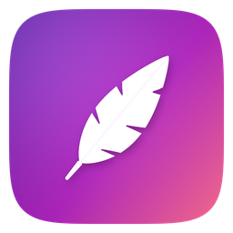

<div align="center">



# FlowBoard

**Kanban boards, storyboards, canvases and notes in one fast, fully local Windows app.**

In the spirit of Trello, Zenkit, Notion and Miro, but your projects live on your PC.
No account, no cloud, no internet needed.

[](https://github.com/GladiusTyrfing/Flow_Board/actions/workflows/build.yml)


[Features](#-features) ·
[Teamwork](#-working-together) ·
[Hotkeys](#%EF%B8%8F-hotkeys) ·
[Download](#-getting-the-app) ·
[Your data](#-where-is-my-data) ·
[Limits](#-limits) ·
[Build](#%EF%B8%8F-building)

</div>

---

## ✨ Features

<table>
<tr>
<td width="50%" valign="top">

### 📋 Boards and cards
- Unlimited boards from templates (Kanban, Project, Bug tracker, Weekly planner, Content pipeline, Personal, Blank) or your own
- Any number of lists: reorder, collapse, colour, sort, copy, archive, **WIP limits**, and "done" lists that complete their cards
- Cards with labels, priority, start and due dates with reminders, **checklists**, comments and an activity log
- **Attachments** dragged from Explorer or **pasted screenshots**, covers, image previews
- **Voice notes** recorded from the microphone with a level meter
- **Time tracking** and a **Pomodoro** timer that logs to the card
- Per-board wallpapers, gradients and dimming

</td>
<td width="50%" valign="top">

### 🗓️ Views
- **Board**: Kanban with drag and drop
- **Table**: a sortable spreadsheet, optionally across every board
- **Calendar**: a month grid; drag cards to reschedule
- **Timeline / Gantt**: drag bars and their edges to change dates, with dependency arrows (red when a card starts before its blocker ends)
- **Home**: stats for every section, a 14-day completion chart, focus time, streaks, "up next" and "jump back in"

</td>
</tr>
<tr>
<td valign="top">

### 🎬 Storyboards
- **Film** or **Animation** mode
- Frames that you pick, paste, drop or **sketch** with a pen or tablet, even over a photo
- **Crop** frames to 16:9, 4:3, 2.39:1, 1:1, 9:16 or freely
- Film: shot type, angle, movement, lens, location, equipment
- Animation: action, dialogue, timing, transitions and **recorded voice lines**
- An **animatic player**, PNG export and printing, and "turn every shot into a card"

</td>
<td valign="top">

### 🧠 Canvas and flowcharts
- An infinite canvas with shapes, sticky notes, text, images and **live cards**
- Drag from a shape's dot to connect it, with curved, straight or elbow connectors
- Mind-map keys (<kbd>Tab</kbd> for a child, <kbd>Enter</kbd> for a sibling), snapping, align and distribute, freehand pen
- **Sections (frames)** that carry their shapes, and **one-click tidy-up** layout
- **Link nodes**: a live preview of any board, shot, canvas, page or card

</td>
</tr>
<tr>
<td valign="top">

### 📝 Notes and pages
- A block editor: headings, to-dos, lists, quotes, callouts, code, dividers, images
- <kbd>/</kbd> opens the block menu; Markdown shortcuts (`#` `-` `1.` `[]` `>` ` ``` ` `---`)
- **Rich text**: bold, italic, underline, strikethrough, code, colours, highlights
- <kbd>@</kbd> links **inline** to any card, board, storyboard, shot, canvas or page
- Covers, icons, an outline, page templates, word count, and Markdown export

</td>
<td valign="top">

### 🔗 Everything is connected
- Link a card to a board, storyboard, **single shot**, canvas or page
- **Done follows the links, both ways**: approve a shot and its cards complete; complete a card and its shots and to-dos are ticked
- *Blocked by* / *blocks* between cards, with loops refused
- **Command palette** (<kbd>Ctrl</kbd>+<kbd>K</kbd>) searches every board, card, storyboard, canvas and page

</td>
</tr>
</table>

### ⚡ Quality of life

| | |
|---|---|
| **Smart quick add** | Type `Call Sam tomorrow 3pm #work !high` and the date, time, label and priority are filled in |
| **Global hotkeys** | Quick-add a card or show/hide FlowBoard from any app |
| **Undo / redo** | For everything, plus an archive you can restore from |
| **Themes** | Dark, light or follow Windows; accent colours; Mica or Acrylic backdrops; a full colour picker everywhere |
| **Styles for every section** | Theme presets, photos, gradients, dimming, blur and panel transparency for storyboards, canvases and pages |
| **Minimaps** | On boards, storyboards, canvases, timelines and pages (<kbd>Ctrl</kbd>+<kbd>M</kbd>) |
| **Screenshots** | <kbd>Ctrl</kbd>+<kbd>Shift</kbd>+<kbd>S</kbd> renders the whole view at **up to 3×** resolution, as PNG or to the clipboard |
| **Notifications** | Windows notifications for due dates and Pomodoro phases; tray icon; start with Windows |
| **Safety** | Autosave every 2 seconds, rolling backups per project, zip backup and restore |

### 📤 Export for other apps

| From | To |
|---|---|
| **Canvas** | SVG · **draw.io / diagrams.net** (same shapes, colours, positions and sections) · Mermaid · JSON graph · PNG |
| **Board** | draw.io board layout · Mermaid · CSV · Markdown · JSON |
| **Storyboard** | CSV shot list · JSON · PNG · print |
| **Page** | Text · JSON · Markdown |

---

## 🤝 Working together

There's no server and no account. Put a project (the `.flowboard` file and its `files` folder) in a
**shared folder**: a network drive, a folder synced with **Syncthing** (direct between computers on
your network, with no internet), or OneDrive, Dropbox or Google Drive.

- When someone else saves, their changes are **merged item by item** into what you have open. Both people's cards, shots, shapes and pages are kept, moves follow, and deletes apply.
- If two people change the same thing at the same moment, **your version is kept** and you're told.
- Conflict copies made by sync apps are merged in automatically.
- The sidebar shows **who else has the project open**.

---

## ⌨️ Hotkeys

Press <kbd>F1</kbd> in the app for the full cheat sheet.

| Where | Keys | Action |
|---|---|---|
| **Anywhere in Windows** | <kbd>Ctrl</kbd>+<kbd>Alt</kbd>+<kbd>Space</kbd> | Quick-add a card over any app |
| **Anywhere in Windows** | <kbd>Ctrl</kbd>+<kbd>Alt</kbd>+<kbd>F</kbd> | Show / hide FlowBoard |
| App | <kbd>Ctrl</kbd>+<kbd>K</kbd> or <kbd>/</kbd> | Command palette and search |
| App | <kbd>Ctrl</kbd>+<kbd>F</kbd> | Filter |
| App | <kbd>Ctrl</kbd>+<kbd>N</kbd> · <kbd>Ctrl</kbd>+<kbd>Shift</kbd>+<kbd>N</kbd> · <kbd>Ctrl</kbd>+<kbd>Shift</kbd>+<kbd>L</kbd> | New card · board · list |
| App | <kbd>Ctrl</kbd>+<kbd>Z</kbd> / <kbd>Ctrl</kbd>+<kbd>Y</kbd> | Undo / redo |
| App | <kbd>Ctrl</kbd>+<kbd>O</kbd> · <kbd>Ctrl</kbd>+<kbd>H</kbd> · <kbd>Ctrl</kbd>+<kbd>M</kbd> | Open project · Home · minimap |
| App | <kbd>Ctrl</kbd>+<kbd>1</kbd>–<kbd>4</kbd> | Board · Table · Calendar · Timeline |
| App | <kbd>Ctrl</kbd>+<kbd>Tab</kbd> · <kbd>Alt</kbd>+<kbd>1</kbd>–<kbd>9</kbd> | Next board · jump to board |
| Hover a card | <kbd>Enter</kbd> <kbd>X</kbd> <kbd>C</kbd> <kbd>Del</kbd> <kbd>Ctrl</kbd>+<kbd>D</kbd> | Open · complete · archive · delete · duplicate |
| Hover a card | <kbd>1</kbd>–<kbd>9</kbd> <kbd>P</kbd> <kbd>T</kbd> <kbd>F</kbd> <kbd>D</kbd> <kbd>L</kbd> | Label · priority · timer · focus · dates · labels |
| Hover a card | <kbd>Alt</kbd>+<kbd>←</kbd>/<kbd>→</kbd> · <kbd>Alt</kbd>+<kbd>↑</kbd>/<kbd>↓</kbd> | Move between lists · up/down |
| Open card | <kbd>Ctrl</kbd>+<kbd>V</kbd> | Paste images or files as attachments |
| Canvas | Double-click · drag a dot · <kbd>Tab</kbd>/<kbd>Enter</kbd> | Add shape · connect · child/sibling |
| Canvas | <kbd>Ctrl</kbd>+drag | Move one shape inside a section |
| Animatic | <kbd>Space</kbd> · <kbd>←</kbd> <kbd>→</kbd> · <kbd>Esc</kbd> | Play/pause · step · close |

Global hotkeys can be changed or turned off in **Settings → Hotkeys**.

---

## 📥 Getting the app

**Download.** Every push builds a single, self-contained `FlowBoard.exe` on GitHub Actions
(**Actions → Build FlowBoard → Artifacts**). No .NET install is needed. It runs on Windows 10
(1809 or later) and Windows 11, x64.

**Projects.** FlowBoard starts on **Home** with nothing open. Create a project (empty or from a
sample) and choose where to save it, open one (<kbd>Ctrl</kbd>+<kbd>O</kbd>), pick a recent one, or
restore a backup zip. A `.flowboard` file is a compressed package with its own icon in Explorer;
double-click it to open it.

---

## 💾 Where is my data?

| What | Where |
|---|---|
| **Projects** | Wherever you save them (by default `Documents\FlowBoard Projects`) |
| **Project files** | `<name>.flowboard`, plus a `<name> files` folder beside it holding `attachments\`, `backgrounds\` and `backups\`. Keep them together. |
| **App settings** | `%AppData%\FlowBoard\settings.json` (theme, hotkeys, recent projects) |
| **Portable mode** | Put an empty `portable.txt` next to `FlowBoard.exe` to keep settings and new projects in a `Data` folder beside the exe |
| **Older versions** | `%AppData%\FlowBoard\data.json` appears in the recent list as **My workspace**. Use **Save project as…** to turn it into a project. |

---

## 🚧 Limits

| | |
|---|---|
| **Platform** | Windows 10 (1809+) and 11 only; FlowBoard is a WPF app |
| **Sync** | No built-in server or cloud. Teamwork needs a shared or synced folder that you provide. |
| **Simultaneous edits** | When two people change the same item at the same moment, only your version is kept, and you're told |
| **Moving projects** | The `.flowboard` file and its `files` folder must travel together |
| **Exports** | draw.io, Mermaid, SVG, CSV and Markdown are one-way. Only FlowBoard's own board JSON can be imported back. |
| **Signing** | The exe isn't code-signed, so SmartScreen may warn on first run |

---

## 🛠️ Building

Requires the [.NET 8 SDK](https://dotnet.microsoft.com/download), or open `FlowBoard.sln` in Visual
Studio 2022 and press <kbd>F5</kbd>.

```powershell
dotnet run --project src/FlowBoard
```

Build a single-file exe:

```powershell
dotnet publish src/FlowBoard -c Release -r win-x64 --self-contained -p:PublishSingleFile=true -p:IncludeNativeLibrariesForSelfExtract=true -o publish
```

Run the tests (they run anywhere, with no Windows UI needed):

```powershell
dotnet test tests/FlowBoard.Tests
```

### Project layout

```
src/FlowBoard/
  Models/        boards, lists, cards, labels, checklists, attachments, settings,
                 documents (storyboards and shots, canvas nodes and edges, pages and blocks)
  Services/      project packages, storage and backups, undo, templates, audio, reminders,
                 Pomodoro, time tracking, tray, themes, global hotkeys, quick-add parser,
                 connector routing and layout, Markdown, stats, link sync,
                 shared-folder teamwork (3-way merge, presence), exporters
  ViewModels/    main window (cards, projects, links, hotkeys, team), card details, calendar,
                 table, timeline, palette, storyboard, canvas, notes, dashboard
  Views/         Board, Table, Calendar, Timeline, card details, storyboard, animatic,
                 sketch pad, canvas, notes, dashboard, settings, dialogs
  Themes/        dark and light palettes, shared styles
tests/FlowBoard.Tests/   models, storage, undo, templates, filters, quick add, routing,
                         Markdown, stats, project files, link sync, merge, exports
tools/make_icons.py      renders the app and .flowboard document icons
```

---

<div align="center">

Built with [WPF-UI](https://github.com/lepoco/wpfui) · [CommunityToolkit.Mvvm](https://github.com/CommunityToolkit/dotnet) · [gong-wpf-dragdrop](https://github.com/punker76/gong-wpf-dragdrop) · [NAudio](https://github.com/naudio/NAudio) · [Plus Jakarta Sans](https://github.com/tokotype/PlusJakartaSans) (OFL)

**FlowBoard** is designed and developed by **Gladius_Tyrfing**. © 2026 Gladius_Tyrfing. All rights reserved.

</div>
